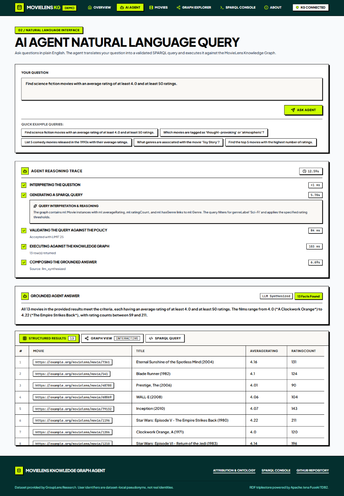
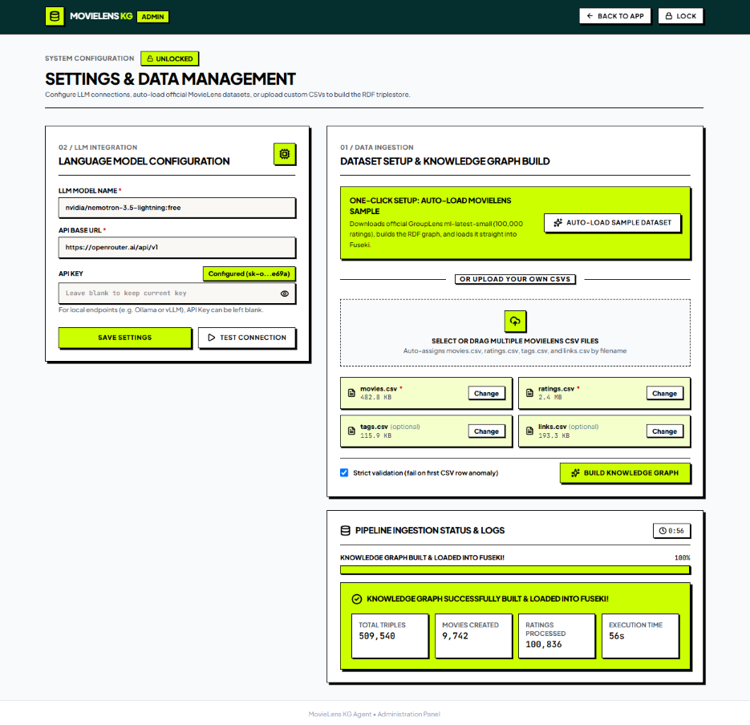

# MovieLens Knowledge Graph AI Agent

A research prototype that turns the MovieLens dataset into an RDF knowledge
graph, stores it in Apache Jena TDB2, serves it through a read-only SPARQL
endpoint (Apache Jena Fuseki), and answers natural-language questions with an
LLM agent that writes SPARQL. Every answer comes from the graph: the response
shows the generated query and the result rows.

It is a **Knowledge Graph construction and LLM-based SPARQL agent prototype**.
It is not a recommender system and not a performance-optimized graph engine.

| Stage | Scope | Status |
|---|---|---|
| 1 | Knowledge graph foundation | implemented |
| 2 | AI agent (natural language → SPARQL) | implemented |
| 2+ | Public research demo web frontend (Neo-Brutalist theme) | implemented |
| 3 | Workload characterization and benchmarking | future research only |
| 4 | Query optimization and hardware-aware execution | future research only |

## Application Preview


*AI Agent Natural Language Interface: Translates English questions into validated SPARQL queries with step-by-step reasoning trace and grounded answers.*


*Data Pipeline & KG Management: 1-click MovieLens dataset setup, SQLite-backed LLM configuration, and live Fuseki triplestore ingestion.*

The public web frontend (search, graph explorer with Cytoscape.js, agent demo page, SPARQL console, and provenance) is located in `frontend/` and served via Docker Compose through the Caddy reverse proxy.

## Project Architecture & Structure

The repository is organized into a clean, intuitive structure with clear separation between backend and frontend concerns:

```text
movielens-kg-agent/
├── backend/                  # Clean Python backend (FastAPI + RDFLib + httpx)
│   ├── agent.py              # LLM Agent: Natural language -> SPARQL -> Grounded Answer
│   ├── api.py                # FastAPI routes (/api/v1/agent, /stats, /settings, /health)
│   ├── cli.py                # CLI commands (mlkg-validate-dataset, mlkg-build-graph)
│   ├── config.py             # Application settings & environment variables (Pydantic)
│   ├── dataset.py            # MovieLens CSV parsing, schema validation & rating aggregation
│   ├── kg_builder.py         # RDF Knowledge Graph builder & Turtle serializer (RDFLib)
│   ├── main.py               # Server entry point (uvicorn factory)
│   ├── models.py             # Clean Pydantic schemas & dataclasses
│   ├── sparql_client.py      # Apache Jena Fuseki SPARQL 1.1 client
│   └── sparql_validator.py   # Read-only query safety, AST validation & LIMIT policy
│
├── frontend/                 # Modern React 19 + TypeScript + Vite + Tailwind CSS web app
│   └── src/
│       ├── api/              # API client (SSE streaming & SPARQL query client)
│       ├── components/       # Modular UI components
│       │   ├── agent/        # Agent reasoning progress trace & structured results
│       │   ├── graph/        # Cytoscape graph styles & interactive node inspector
│       │   └── settings/     # Admin PIN authentication, LLM form, and dataset upload logs
│       └── pages/            # Application views (Overview, Agent, Movies, Explore, SPARQL, Settings)
│
├── datasets/                 # Location for MovieLens CSV files (e.g., ml-latest-small)
├── docker/                   # Apache Jena Fuseki container setup and Caddy reverse proxy
├── docs/                     # Architectural decisions, data model, and API reference
└── tests/                    # Pytest test suite (unit, integration, and API tests)
```

## Quick start

Requirements: Python 3.12 and [uv](https://docs.astral.sh/uv/) (or `pip`).
Docker is needed only for Fuseki.

```bash
# 1. Install
uv sync                      # or: python -m venv .venv && pip install -e . pytest ruff mypy

# 2. Get the data (see docs/dataset-usage.md)
#    Extract ml-latest-small into datasets/ml-latest-small/ and create the manifest:
cp datasets/manifest.example.json datasets/ml-latest-small/manifest.json   # then edit it

# 3. Validate and build the graph
uv run mlkg-validate-dataset --source datasets/ml-latest-small
uv run mlkg-build-graph --source datasets/ml-latest-small \
    --output data/processed/movielens.ttl --report data/reports/import-report.json

# 4. Configure the LLM, load into TDB2, and start Fuseki + API + proxy
cp .env.example .env         # set LLM_BASE_URL, LLM_MODEL, LLM_API_KEY
docker compose build
docker compose run --rm kg-loader load
docker compose up -d
```

The same commands are available as scripts: `python scripts/validate_dataset.py`
and `python scripts/build_knowledge_graph.py`. Run any command with `--help`
for all options. `--tolerant` skips invalid rows instead of stopping (every
skipped row is listed in the report).

Ask the agent:

```bash
curl -s http://127.0.0.1:2001/api/v1/agent/query \
  -H 'Content-Type: application/json' \
  -d '{"question": "What are the top five movies by average rating among movies with at least 50 ratings?"}'
```

The response contains the `answer`, the `generated_sparql`, the `results`,
and dataset information. Unsafe generated queries (updates, `SERVICE`,
`FROM`, missing or too-large `LIMIT`) are rejected before they reach the graph.
See [docs/api.md](docs/api.md).

Query the graph directly:

```bash
curl -G http://127.0.0.1:2001/sparql \
  -H 'Accept: application/sparql-results+json' \
  --data-urlencode query@docs/examples/sparql/02-movies-by-genre.rq
```

### Web Frontend Development

The frontend is a standard Vite + React project. You can use either **npm** (Node.js) or **Bun**:

```bash
cd frontend

# Using npm:
npm install
npm run dev      # starts development server on http://localhost:3000
npm run build    # checks TypeScript and builds production assets in dist/

# Or using Bun:
bun install
bun run dev
bun run build
```

The web application is styled with a **Neo-Brutalist (Programmer Zaman Now)** design aesthetic featuring dark tosca navigation/footer, warm paper canvas, crisp black borders, and punchy neon lime accents:
- **Overview (`/`)**: Graph entity statistics, ontology highlights, and architecture flow.
- **AI Agent Demo (`/agent`)**: Natural language question input with 3-panel grounded answers, generated SPARQL, and structured table data.
- **Movies (`/movies` & `/movies/:id`)**: Search by title, genre chips filter, rating aggregate, and embedded neighborhood graph.
- **Graph Explorer (`/explore`)**: Bounded Cytoscape.js interactive topology graph with node inspector drawer.
- **SPARQL Console (`/sparql`)**: Read-only query execution with presets and JSON export.
- **About (`/about`)**: GroupLens attribution, citation, and pseudonymous user ID privacy disclosure.

## Development

```bash
uv run pytest                 # unit, integration, and API tests (Fuseki/e2e tests are skipped)
uv run ruff check .
uv run ruff format --check .
uv run mypy
scripts/deployment_smoke_test.sh   # optional: full Docker stack check (needs Docker)
```

CI (`.github/workflows/ci.yml`) runs the checks and the Docker smoke test on
every push to `main`.

Tests never call a real LLM; they use a deterministic fake. Tests that need a
running Fuseki are marked `fuseki` / `e2e` and run only when
`FUSEKI_TEST_QUERY_ENDPOINT` / `E2E_FUSEKI_QUERY_ENDPOINT` are set (see
[docs/deployment.md](docs/deployment.md)).

## Documentation

| Document | Contents |
|---|---|
| [docs/architecture.md](docs/architecture.md) | High-level system architecture, ingestion pipeline, agent sequence, and Docker services |
| [docs/data-model.md](docs/data-model.md) | RDF ontology classes, properties, IRI rules, and CSV mapping |
| [docs/api.md](docs/api.md) | Agent query endpoints, SSE streaming, stats, and response schemas |
| [docs/dataset-usage.md](docs/dataset-usage.md) | MovieLens dataset source, download steps, license, and citation |
| [docs/deployment.md](docs/deployment.md) | Docker Compose instructions, loading, backup/restore, and environment settings |
| [docs/decisions.md](docs/decisions.md) | Architecture Decision Records (ADRs) |
| [docs/examples/sparql/](docs/examples/sparql/) | Tested example SPARQL queries |
| [docs/examples/import-report.sample.json](docs/examples/import-report.sample.json) | Sample graph construction import report |

## Dataset acknowledgement

This project uses the MovieLens dataset from GroupLens Research. The dataset
is **not** included in this repository. This project is not endorsed by the
University of Minnesota or the GroupLens Research Group.

> F. Maxwell Harper and Joseph A. Konstan. 2015. The MovieLens Datasets:
> History and Context. ACM Transactions on Interactive Intelligent Systems
> (TiiS) 5, 4: 19:1–19:19. <https://doi.org/10.1145/2827872>

Apache Jena (Fuseki, TDB2) is licensed under the Apache License 2.0.
