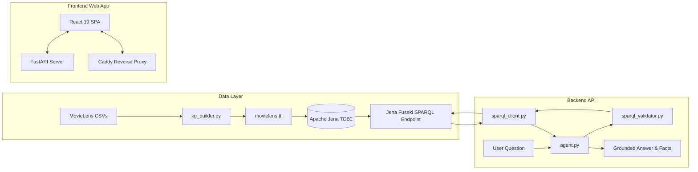
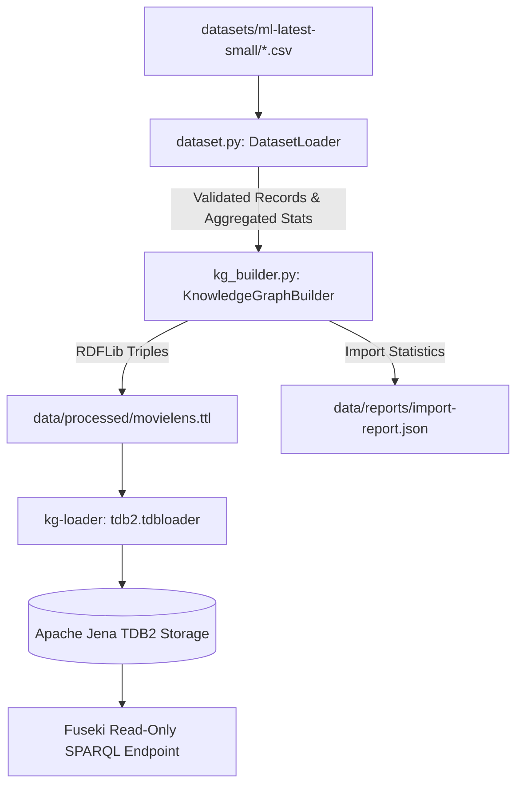
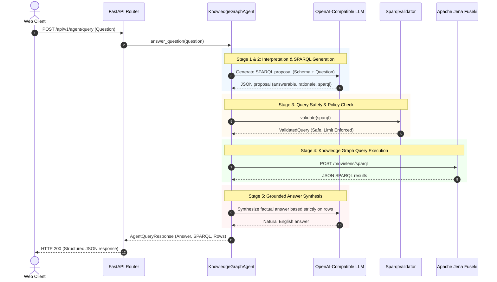

# System Architecture

This document outlines the architecture of the MovieLens Knowledge Graph AI Agent, including the data ingestion pipeline, SPARQL validation safeguards, the LLM agent flow, and runtime container services.

---

## 1. High-Level Architecture

The system consists of two primary subsystems:
1. **Knowledge Graph Construction Pipeline**: Ingests MovieLens CSV datasets, computes movie rating statistics, builds an RDF graph using RDFLib, and stores it in an Apache Jena TDB2 persistent graph database served by Fuseki.
2. **Grounded AI Agent & Web Application**: Provides a natural language interface that translates questions into validated SPARQL queries, retrieves factual graph rows from Fuseki, and synthesizes grounded answers.

---

## 2. Backend Modules & Responsibilities

The backend is built with a flat, modular structure where each module has a clear and focused responsibility:

| Module | File | Responsibility |
|---|---|---|
| **Agent** | `backend/agent.py` | Orchestrates LLM prompt creation, SPARQL generation, validation calls, and final answer synthesis. |
| **API** | `backend/api.py` | FastAPI application exposing agent endpoints, Server-Sent Events (SSE) streaming, stats, and admin settings. |
| **Dataset Loader** | `backend/dataset.py` | Parses MovieLens CSV files (`movies.csv`, `ratings.csv`, `tags.csv`, `links.csv`), checks schema, and aggregates movie ratings. |
| **Graph Builder** | `backend/kg_builder.py` | Converts parsed in-memory entities into RDF triples using RDFLib and serializes to Turtle format (`.ttl`). |
| **SPARQL Client** | `backend/sparql_client.py` | Executes validated SELECT queries against Apache Jena Fuseki over HTTP and normalizes JSON results. |
| **Query Validator** | `backend/sparql_validator.py` | Enforces read-only safety, blocks harmful operations (`SERVICE`, `INSERT`, `DELETE`), and ensures `LIMIT` clauses. |
| **Settings** | `backend/config.py` | Centralized application configuration using Pydantic Settings and environment variables. |
| **CLI** | `backend/cli.py` | Command-line scripts for dataset validation (`mlkg-validate-dataset`) and graph construction (`mlkg-build-graph`). |

---

## 3. Knowledge Graph Construction Flow

### Ingestion Details
- **Rating Aggregations**: During CSV loading, movie ratings are aggregated in memory to precalculate `ml:ratingCount` and `ml:averageRating` (rounded to 2 decimal places).
- **Turtle Output**: Triples are exported with standard prefixes (`ml:`, `rdf:`, `rdfs:`, `xsd:`, `dct:`).
- **Import Report**: A JSON summary containing total triple count and timestamps is saved for zero-latency dashboard stats.

---

## 4. Grounded AI Agent Execution Flow

Every request to `/api/v1/agent/query` follows a strictly bounded 5-stage pipeline:

### Safety and Security Safeguards
1. **Read-Only Enforcement**: Queries containing write operations (`INSERT`, `DELETE`, `LOAD`, `CLEAR`, `DROP`, `CREATE`) are rejected before execution.
2. **Anti-Federation (`SERVICE`)**: The `SERVICE` keyword is blocked to prevent Server-Side Request Forgery (SSRF) and external network calls.
3. **Automatic `LIMIT` Enforcement**: If the generated query omits a `LIMIT`, a default limit (e.g., 50) is automatically injected. If the requested limit exceeds the maximum allowable threshold (500), it is clamped.
4. **AST Syntax Parsing**: Queries are parsed into an abstract syntax tree using RDFLib's SPARQL parser to prevent injection bypasses through string tricks or comments.

---

## 5. Runtime Services (Docker Compose)

The deployment stack is orchestrated through `docker-compose.yml`:

| Service | Container Image | Port | Description |
|---|---|---|---|
| **fuseki** | `movielens-kg-agent/fuseki:6.2.0` | Internal (`3030`) | Apache Jena Fuseki running on Java 21 serving the persistent TDB2 store. |
| **api** | `movielens-kg-agent/api:0.1.0` | Internal (`8000`) | FastAPI service serving the agent and admin endpoints. |
| **web** | `movielens-kg-agent/web:0.1.0` | Internal (`80`) | Nginx container serving the compiled React 19 single-page application. |
| **proxy** | `caddy:2.11.9-alpine` | `2001` (HTTP), `2002` (HTTPS) | Reverse proxy providing routing, TLS, and request size limiting. |
| **kg-loader** | `movielens-kg-agent/fuseki:6.2.0` | None (CLI tool) | One-shot tool for offline database loading (`tdb2.tdbloader`) and backups. |
